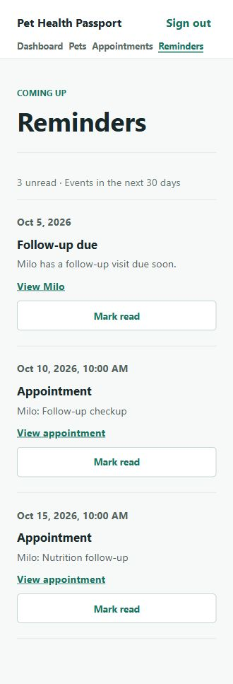
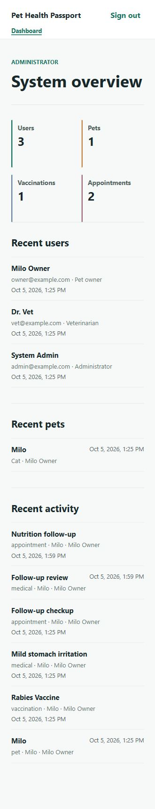

# Pet Health Passport: Final Project Report

Updated 6 November 2026. The October browser/Jenkins evidence below is historical; current CI and kind results must be checked live before presentation.

## 1. Project summary

Pet Health Passport is a full-stack web application that keeps a pet's profile and health history in one place. Owners manage pet records and view appointments/reminders; vets manage care and appointments; admins manage users and system data. Owners can opt in to appointment emails delivered by a RabbitMQ-backed worker to a local SMTP test inbox. The project demonstrates Docker Compose, Jenkins, and local Kubernetes deployment.

## 2. Problem and objectives

Pet health information often lives in paper records, photos, messages, and separate clinic files. This makes it difficult to find the right information during a visit or remember a future care date. The application gives each pet a structured record and shows upcoming care in the owner's dashboard.

The delivered objectives are:

1. Authenticate users and restrict routes by role.
2. Let owners manage their own pets and health records.
3. Show appointments and reminders derived from care dates.
4. Give owners and admins separate dashboards.
5. Build, test, and deploy the application through Jenkins and Docker Compose.
6. Let owners opt in to appointment emails processed by a RabbitMQ worker.

## 3. Scope and users

| Role | Delivered behavior |
| --- | --- |
| Owner | Register, sign in, manage own pets and records, view appointments/reminders, opt in to appointment emails, view dashboard |
| Vet | Find and take pets into care, manage appointments for pets in care, read records and add medical visits |
| Admin | Manage users, pets, health records, appointments and vet assignments; view system statistics |

Public shareable passports and QR codes remain outside the delivered application. Admin user management is implemented.

## 4. System design

```text
Browser -> React/Vite (Nginx in Docker) -> Express REST API -> PostgreSQL
                                               |
                                               +-> local document storage volume
PostgreSQL -> notification worker -> RabbitMQ -> notification worker -> SMTP/Mailpit
```

The frontend stores the JWT in browser session storage and sends it as a bearer token. The backend checks the token and role before protected routes. Owner queries are scoped to the authenticated owner's pets. PostgreSQL holds users, pets, health records, appointments, and reminder read state. Uploaded documents are kept in a Docker volume.

The database also contains `pet_vet_access` and `appointment_notifications`. Reminders shown in the application are derived from care dates; the `reminders` table stores read state. The separate notification table stores appointment email attempts and results. The worker scans due appointments, publishes job IDs and appointment dates to RabbitMQ, and sends via SMTP after checking the latest appointment and opt-in state.

## 5. Implemented features

- Registration, login, logout, JWT authentication, and role checks.
- Pet profile creation, listing, detail, editing, and deletion for the owner.
- Vaccination, medical, allergy, medication, and weight record management.
- PDF, PNG, and JPEG document upload and authenticated download.
- Appointment creation, editing, status changes, and deletion.
- In-app reminders for events in the next 30 days, with read state.
- Opt-in email reminders for appointments via RabbitMQ, a separate worker, SMTP and local Mailpit; retry up to five times.
- Owner dashboard with counts, upcoming care, recent records, and weight chart.
- Admin dashboard with counts, recent users and pets, and recent activity.
- Vet self-assignment to pets, admin-managed access, shared history, and vet-authored medical visits.
- Admin user management and role changes.
- Docker Compose services for PostgreSQL, RabbitMQ, Mailpit, API, worker and frontend; Jenkins pipeline for checkout, tests, build, deployment, and health checks.

## 6. Verification

On 5 October 2026, the local demo flow was exercised in the browser:

| Step | Observed result |
| --- | --- |
| Owner sign-in | Opened owner dashboard with Milo and upcoming care |
| Pet profile | Milo's details and existing health records loaded |
| Add medical visit | A new 5 October follow-up review appeared in medical visits |
| Create appointment | A 15 October nutrition follow-up appeared in upcoming appointments |
| Reminders | The new appointment appeared as an unread reminder |
| Admin sign-in | Dashboard showed 3 users, 1 pet, 1 vaccination, 2 appointments, and the new activity |
| Vet access (5 October 2026) | Owner shared Milo, vet read records and added a visit, owner saw the visit, and revocation blocked further access. The test visit was removed afterward. |

Jenkins job `pet-health-passport` build #1 completed successfully, including backend tests, frontend build, Docker build and deployment, and health check. The pipeline result is available locally at `http://localhost:8080/job/pet-health-passport/1/` while Jenkins is running.

On 6 November 2026, the RabbitMQ notification feature passed 16 backend tests (one database integration test was skipped because it requires a separate test database). Docker Compose and kind both reached healthy/ready state. In each environment, an opted-in demo owner received a new appointment email in Mailpit through RabbitMQ and the worker. The test appointment was deleted and the owner's prior email preference restored. The updated Jenkins pipeline has not been run yet; build #1 is historical evidence.

Browser evidence from the local demo:





The new demo records live in the current local PostgreSQL volume. A fresh volume is initialized from `database/seed.sql`, which now uses dates relative to initialization so the appointment and follow-up reminders remain demonstrable later. The schema and seed were also run in a rolled-back PostgreSQL transaction: they created 3 users, 1 pet, 1 upcoming appointment, and 1 upcoming follow-up without changing the live database.

## 7. Limitations and future work

- The GitHub webhook is configured in the pipeline but cannot receive GitHub events until Jenkins has a public HTTPS URL and the repository webhook is created.
- Vets can add medical visits for pets in care, but cannot edit or delete existing health records.
- Email delivery is implemented for opted-in appointment reminders only and is captured locally by Mailpit. Production SMTP credentials, deliverability and bounce handling are not configured. Push and LINE delivery are not implemented. At-least-once processing can yield a duplicate if SMTP accepts a message immediately before a worker crash.
- Document files use local Docker storage, so a production deployment would need backup and storage planning.
- The seed is intended for a classroom demo, not production data. Demo passwords must not be used for a public deployment.

## 8. Conclusion

The owner journey from pet record to in-app reminder and optional appointment email works locally. Vets manage care and scheduling; admins manage users and data. Docker Compose and local Kubernetes provide repeatable deployments, while Jenkins defines the CI/CD path. Remaining work includes production email integration, a public webhook, and the optional QR/shareable passport.
